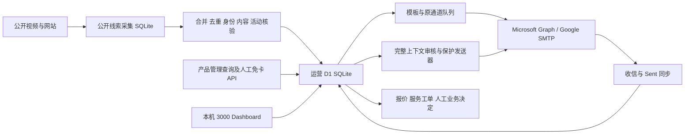

# 代码架构

## 运行边界

前端使用 React、Next 兼容的 vinext、Vite 和 Cloudflare Worker/D1 本地模拟；Python 承担后台批处理。原本通过 macOS launchd 调度，并非浏览器点一下就执行全部流程。数据不是单一 CSV，至少有运营 SQLite、线索 SQLite、私有产品和账单系统四层。

## 主要模块

| 路径 | 职责 | 接手注意 |
|---|---|---|
| app/page.tsx | 首页、通道状态、计划与进度 | 部分历史界面仍显示扩展目标，不能视为批准新额度 |
| app/operations-center.tsx | 运营工作项、创作者 profile | 业务状态需结合真实证据 |
| app/conversation-center.tsx | 会话展示 | 列表 preview 不是全文 |
| app/feedback-center.tsx | 产品反馈 | 支持回复不是实际修复 |
| app/api/outreach/route.ts | 联系人与基础数据库、收发操作 | 首次空库读取会初始化表与空种子 |
| app/api/operations/route.ts | 模板、规则、运营状态、产品管理连接 | 路由很大；后续应拆服务层和权限边界 |
| app/lib/reply-context.ts 及 SQL | 完整本地上下文快照 | 保持历史问题、完整性检查与摘要分离 |
| scripts/continuous_lead_discovery.py | 公开搜索和频道/邮箱采集 | 原 8 worker，48 小时查询冷却，身份与活动门槛 |
| scripts/discovery_topics.py / discovery_learning.py | 查询主题和发现反馈 | 不用重复查询与降低门槛凑库存 |
| scripts/merge_lead_discovery.py | 线索库合并到运营库 | 数据合并不等于最终可发资格 |
| scripts/creator_activity.py | 近 30 天活动证据与缓存 | 403/429 不绕过，时间必须准确有时区 |
| scripts/initial_template_router.py | 首邀模板分流、地址校验 | 新修复拦截编码空格，不自动修地址 |
| scripts/replenish_initial_queue.py | 补充合格预约 | 不能跨原通道借额度或重复未知提交 |
| scripts/outreach_scheduler.py | ET 窗口、原通道限额、间隔、初次去重与结果日志 | unknown 计入原日额度并停止当轮 |
| scripts/inbox_sync.py / gmail_history_sync.py | 来信、系统通知和 Sent 同步 | 保存完整正文，不能只用 bodyPreview |
| scripts/reply_template_router.py | 回复分类、可选本地 Codex 辅助路由 | AI 输出不是付款/许可授权 |
| scripts/reply_context.py / reply_safety.py | 上下文完整性和发送保护 | 新证据必须完整重读 |
| scripts/send_reviewed_simple_trial.py | 明确审核 manifest 的逐封发送 | 带原始历史 ID 的默认批次不能直接重跑 |
| scripts/gmail_reviewed_reply.py | Google 原线程、固定 Message-ID、独立锁 | 不明禁止自动重试 |
| scripts/send_coupon_replies.py / safe_workflow_reply_agent.py | 受规则限制的常规回复 | 脱敏副本中的历史个案邮箱不是生产禁发全集 |
| scripts/creator_followup_agent.py | 按历史配置跟进 | 不对服务 pending 或持久 hold 自动追发 |
| scripts/creator_data_agent.py | 真实账号使用、报价解析、产品 API | 查无不是已删除；核销和任务分开 |
| scripts/execute_reviewed_cardless.py | 人工批准免绑卡开通 | 稳定幂等、精确账号、非 Stripe、到期和确认信 |
| scripts/reviewed_contact_hold.py | 持久 hold 与 SQLite 触发器 | 不能被同步或旧导入解除 |
| scripts/reviewed_service_case.py | 未解决服务 case 与触发器 | 没有解决证据不得关闭 |
| scripts/outreach_health_check.py | 历史健康检查与恢复辅助 | 用户暂停时也必须暂停，不能自动重启已停任务 |
| build/billing-local.mjs | 可选本地 Stripe 只读视图 | 默认关闭，依赖外部私有文件和独立 reminder 模块 |

## 数据源与优先级

原运营库是 .wrangler/state/v3/d1 下的实际 SQLite 文件，不是仓库根目录几个同名备份库。线索库原为 data/lead-discovery.sqlite。发送事实优先看数据库和精确提供商证据，再看 review-queue-index、send 日志和 operations-report。旧 report 只是快照，不能覆盖更新的发送结果。

本仓库 handoff/schema-current.sql 从实际运营库提取全部结构，不含数据。它比散落的历史 migration 更适合了解今天的结构；db/ 与 drizzle/ 的老迁移有政策和种子写入，不能无脑全部重放到生产。

## 部署与凭证依赖

Node 依赖固定在 package-lock.json；Python 原环境为 3.13，主要使用标准库与 yt-dlp。Unix 的 fcntl、macOS Keychain、launchctl 和部分本机路径使后台不具备开箱即用的 Windows 可移植性。

Microsoft OAuth 的 refresh token 存在私有运营库；Google SMTP app password 与产品令牌原通过 Keychain/环境提供。源码中导出的租户与 client ID 已替换为占位值；实际密钥不能提交 Git。产品接口契约包括精确邮箱查询、emailVerified、subscription、activity 和 coupon，不包含所有 Stripe 交易或取消字段。

账单模块有独立只读 Stripe 来源，不能将其存在推断为外联 AI 获得退款、取消或删除权限。外部 renewalSchedule.js 不在本项目，副本默认不加载账单插件，正式启用需额外迁移该依赖并单独验收。
